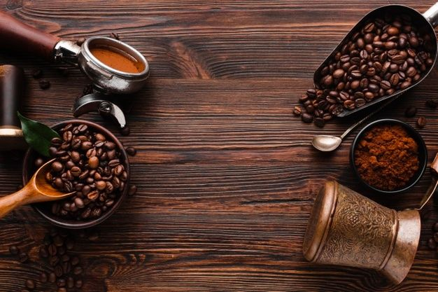
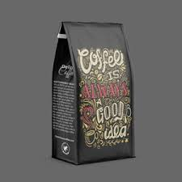
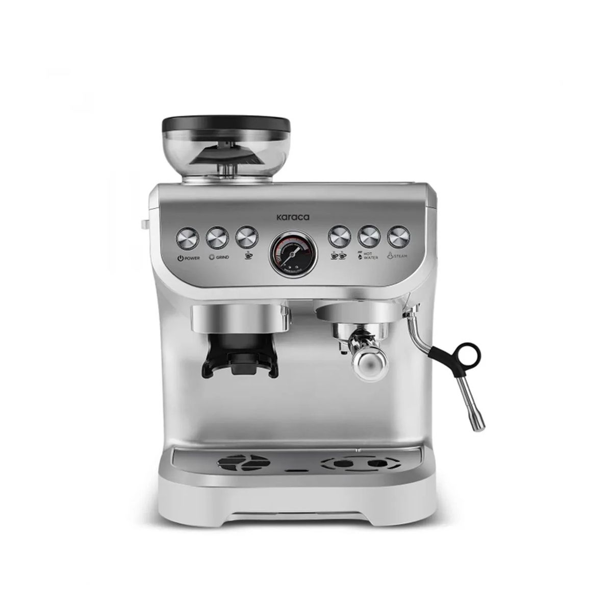

# Bean Boutique Coffee Shop

A static, multi-page coffee shop website showcasing drinks, brewing equipment, events, promotions, and a browser-based shopping cart.

## At a glance — what is this project?

| | |
| --- | --- |
| **Project** | Bean Boutique Coffee Shop |
| **Type** | Static front-end demo website — six pages for a fictional coffee shop |
| **What it does** | Drinks/machines catalogues, events, promotions, image slideshow, newsletter popup, `localStorage` demo cart, forms that only show local confirmations |
| **Tech** | HTML5, CSS3, vanilla JavaScript (inline) · Font Awesome · SweetAlert2 — no backend or database |
| **Ports** | No install/build needed — open `home.html` directly. Optionally: `python -m http.server 8000` → `http://localhost:8000/home.html` |
| **Status** | Fictional demo site. Forms do not really submit. Icons and notifications need an internet connection. |

In short: A front-end-only demo site for a fictional coffee shop: six linked HTML pages with a slideshow, catalogues, events, promotions and a `localStorage` cart. No backend or database — forms only show local confirmations.

## Overview

Bean Boutique Coffee Shop is a front-end-only demo site for a fictional coffee shop. It consists of six linked HTML pages sharing one stylesheet, with inline vanilla JavaScript for the image slideshow, newsletter popup, event registration, shopping cart, and promotional alerts. There is no backend or database: cart contents are stored in the browser's `localStorage`, and form submissions only display local confirmations. Icons, SweetAlert2 notifications, reCAPTCHA, and Google Maps are loaded from external services, so an internet connection is needed for those features to appear.

## Visual guide — what the images are

| Image | What it is / where it is used |
| --- | --- |
|  | **`image/slide.jpg`** — the first image in the homepage slideshow in `home.html` (the other two are `slide2.jpg` and `slide3.jpg`). |
|  | **`image/coffee1.jpg`** — one of the twelve drink photos (`coffee1.jpg`–`coffee12.jpg`) displayed on `coffee selection.html`. |
|  | **`image/d125...jpg`** — one of the product photos used by the `machine.html` catalogue. |

These are the **source images** used by the pages, not screenshots of a browser window. The site is front-end only, so no deployed application screenshots exist.

## Pages Included

- `home.html` — landing page with hero section, image slideshow, featured drinks, map embed, and newsletter popup.
- `coffee selection.html` — catalogue of coffee drinks with "Buy Now" buttons.
- `machine.html` — catalogue of coffee machines for sale.
- `event.html` — upcoming events and an on-page registration form.
- `promotion.html` — current special offers.
- `shopping.html` — cart table with remove-item and checkout actions.

## Tech Stack

- HTML5, CSS3, vanilla JavaScript (inline `<script>` blocks)
- Browser `localStorage` and `sessionStorage` for the demo cart and gate state
- Font Awesome (icons), SweetAlert2 (cart notifications)
- Google Maps embed on `home.html` (the non-functional Maps JavaScript API snippet and reCAPTCHA test widget were removed because they had no working key or form)

## How to Open / Run Locally

No build step, package installation, or server is required.

1. Download or clone this repository.
2. Open `home.html` in a modern web browser.

Optionally, serve the folder over HTTP for more consistent browser behaviour:

```bash
cd github-work/coffee_project
python -m http.server 8000
```

Then visit `http://localhost:8000/home.html`.

An internet connection is required for the external icons, scripts, reCAPTCHA, and map.

## Project Structure

```text
coffee_project/
├── home.html
├── coffee selection.html
├── machine.html
├── event.html
├── promotion.html
├── shopping.html
├── style.css
├── image/          # hero, slideshow, drink, and machine images
└── download.jpg    # unused image at repository root
```

## Notes

- Checkout, event registration, and offer interactions are client-side demos; no data is sent to a server.

## License

MIT — see [LICENSE](LICENSE).

## Author

Thwin Htoo Aung
